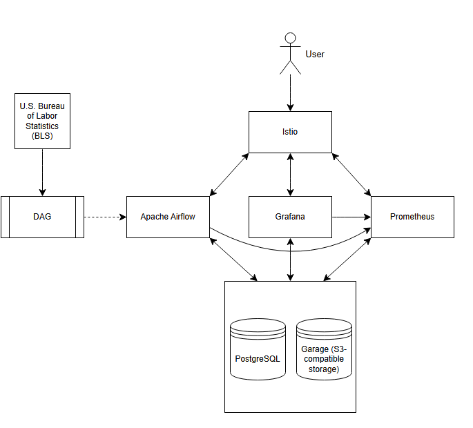

# Economic Nowcasting Platform

## What this project can do

This is the repository containing the infrastructure configuration for my Economic Nowcasting Platfom. The services for this platform include:

* Grafana
* Prometheus
* Apache Airflow
* Istio
* PostgreSQL
* Garage 

### Grafana

Grafana allows the creation of dashboards, displaying collected metrics. The dashboards are used for a variety of different tasks, including monitoring service health, data analysis, and visualising model training metrics.

### Promethueus (Prometheus Operator)

Prometheus collects and stores metrics periodically scraping configured endpoints exposed by the platform's services. The Prometheus operator manages the deployment and configuration of Prometheus.

### Apache Airflow

Apache Airflow is a task orchestrator, running code on specified schedules. Additionally, it stores the logs from code runs in an external database, which can then be used to diagnose any issues later.

### Istio (ingress)

Used as a reverse-proxy to provides a common entry point for accessing services, and avoid port-forwarding each service individually.

### PostgreSQL (CloudNativePG)

A structured data store containing metrics (not Prometheus metrics), databases for other serivces, and details regarding API endpoints.

CloudNativePG manages the PostgreSQL deployment.

### Garage

Garage provides S3-compatible object storage. In this project, it is primarily used to store bulk datasets retrieved by data pipelines.

This is the current relationship between the platform's infrastructure services.

## Dags and Data

The data that is currently being used is a collection of observation series obtained from the public U.S. Bureau of Labor Statistics (BLS) API. The specific observations were decided by looking for uncorrelated data. Since the public BLS API has a rate limit, it was important that I reduce the amount of data scraped, whilst keeping as much unique information as possible. The link to the repo containing the DAG code and notebook used to analyse the observations can be found [here](https://github.com/domjina/data_dags).

## Next steps

* Add more observation series to my dataset.
* Add CI lint checkers for DAGs.
* Create more Grafana dashboards (DAG runs, resource usage)